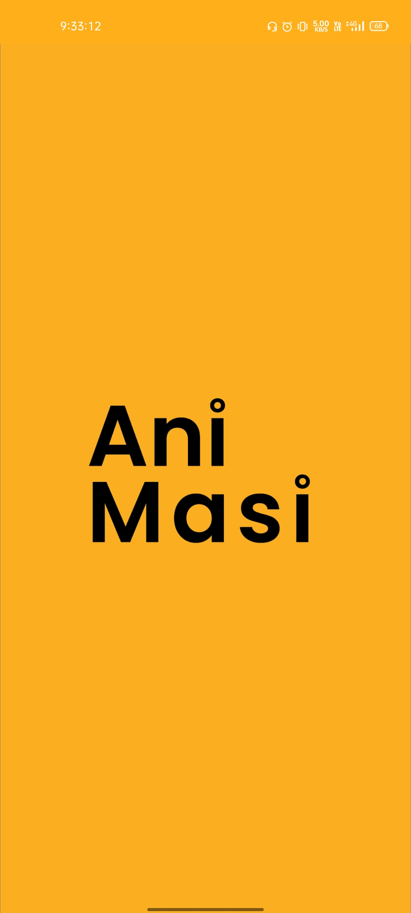
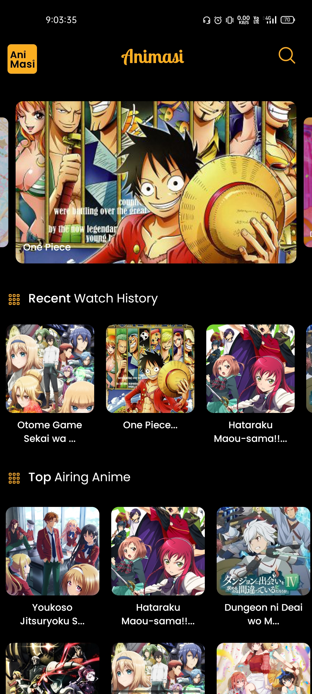
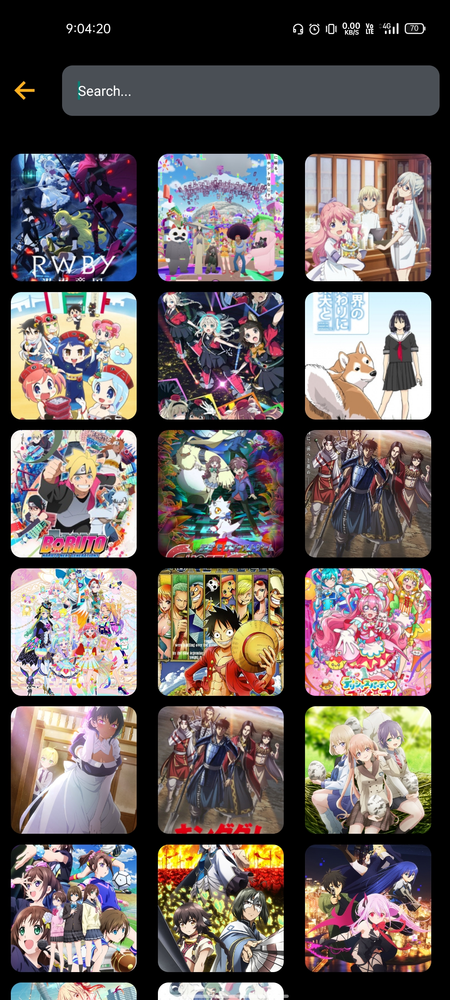
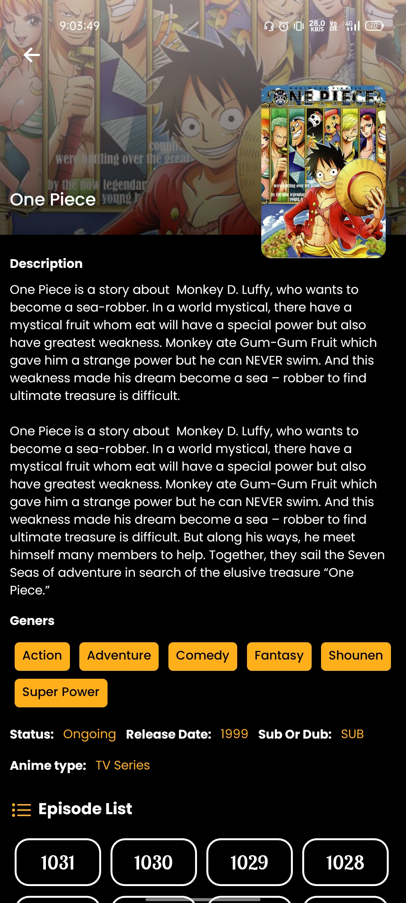
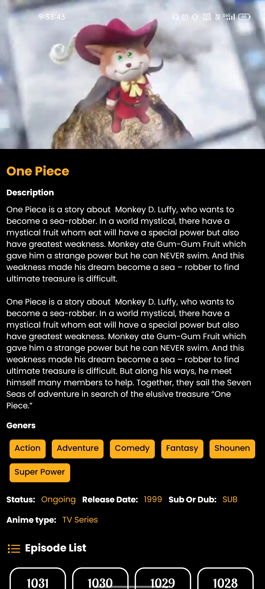

<div align="center">


# Animasi

### A React Native anime streaming app built with the Consumet API

<br/>

[](https://reactnative.dev)
[](https://expo.dev)
[](https://developer.mozilla.org/en-US/docs/Web/JavaScript)
[](https://consumet.org)
[](https://github.com/6ixline/Animasi/stargazers)
[](https://github.com/6ixline/Animasi/network/members)

<br/>

> A fully-featured **anime streaming mobile app** for Android - browse trending anime, search titles, watch episodes, and track your watch history. Officially featured in the [Consumet Showcase](https://consumet.org/showcase/animasi/). ⭐ 47 stars · 🍴 14 forks

</div>

---

## 📋 Table of Contents

- [Screenshots](#-screenshots)
- [Features](#-features)
- [Tech Stack](#-tech-stack)
- [Project Structure](#-project-structure)
- [Getting Started](#-getting-started)
- [API](#-api)
- [Contributing](#-contributing)

---

## 📸 Screenshots

<div align="center">







</div>

---

## ✨ Features

- 🏠 **Home Screen** - Browse trending, popular, and recently updated anime
- 🔍 **Search** - Search any anime title instantly via Consumet API
- 📺 **Episode Watch** - Stream episodes directly in-app with a built-in video player
- 📄 **Anime Details** - Full details page with synopsis, episode list, genres and status
- 📜 **Watch History** - Automatically tracks episodes you've watched
- 🎨 **Clean UI** - Dark themed, mobile-first design built for Android

---

## 🛠️ Tech Stack

| Technology | Purpose |
|---|---|
| **React Native** | Cross-platform mobile UI |
| **Expo SDK 46** | Build toolchain & native APIs |
| **React Navigation** | Stack & bottom tab navigation |
| **Consumet API** | Anime data & streaming source (GogoAnime) |
| **Expo AV** | In-app video playback |
| **AsyncStorage** | Local watch history persistence |

---

## 📁 Project Structure

```
Animasi/
├── App.js                    # App entry point, navigation container
│
├── screens/                  # All app screens
│   ├── HomeScreen.js         # Trending & popular anime feed
│   ├── SearchScreen.js       # Search anime by title
│   ├── DetailsScreen.js      # Anime info + episode list
│   ├── WatchScreen.js        # In-app video player
│   └── HistoryScreen.js      # Watch history
│
├── component/                # Reusable UI components
│   ├── AnimeCard.js          # Anime thumbnail card
│   └── EpisodeList.js        # Episode list renderer
│
├── navigation/               # React Navigation setup
│   └── AppNavigator.js       # Stack + tab navigator config
│
├── config/                   # API config & constants
│   └── api.js                # Consumet API base URL & endpoints
│
├── utils/                    # Helper functions
│   └── storage.js            # AsyncStorage watch history helpers
│
├── assets/                   # Images, logo, fonts
└── screenshot/               # App screenshots
```

---

## 🚀 Getting Started

### Prerequisites

- **Node.js** v16+
- **Expo CLI** - `npm install -g expo-cli`
- **Expo Go** app on your Android device or Android emulator

### Installation

```bash
# 1. Clone the repository
git clone https://github.com/6ixline/Animasi.git
cd Animasi

# 2. Install dependencies
yarn install

# 3. Start the Expo development server
expo start
```

Then:
- **On device** - Scan the QR code with the **Expo Go** app
- **On emulator** - Press `a` to open on Android emulator

### Build APK

```bash
# Using EAS Build
eas build --platform android --profile preview
```

---

## 🔌 API

Powered by the **[Consumet API](https://github.com/consumet/consumet.ts)** - a free, open-source API for anime content from **GogoAnime**.

| Endpoint | Description |
|----------|-------------|
| `/anime/gogoanime` | Browse trending & recent anime |
| `/anime/gogoanime/:query` | Search anime by title |
| `/anime/gogoanime/info/:id` | Anime details & episode list |
| `/anime/gogoanime/watch/:episodeId` | Streaming sources for an episode |

> ⚠️ This app is for **educational purposes** only. Please respect the original content providers.

---

## 🏆 Recognition

Animasi is officially featured in the **[Consumet Showcase](https://consumet.org/showcase/animasi/)** - a curated list of apps built with the Consumet API.

---

## 🤝 Contributing

Contributions, issues and feature requests are welcome!

```bash
git checkout -b feature/your-feature
git commit -m "feat: add your feature"
git push origin feature/your-feature
```

---

## 📄 License

This project is open source and available under the [MIT License](LICENSE).

---

<div align="center">

Built with ❤️ for anime fans

⭐ If you like this project, give it a star!

**[⬆ Back to top](#animasi)**

</div>
